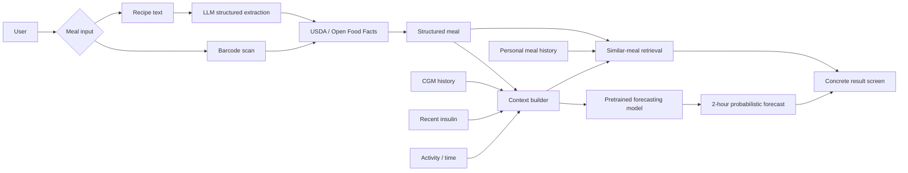

# GlycoLens: Updated Project Summary

## November 14: GitHub checkpoint authorization

The user authorized committing and pushing the current implementation checkpoint on `main`, superseding the local-review hold for these changes. [Delivery scope and checks](../reports/github-checkpoint-delivery-2026-11-14.md) cover Plans 18 and 19. Publishing source does not close partial acceptance gates or deploy a hosted application. Earlier local-only notes below describe their dated checkpoints.

## November 14: personal and simulation workspaces implemented

One account now has independent personal and simulation workspaces. Personal logging/totals work without CGM, using current profile-local days; virtual readings/forecasts and their original timestamps stay in `/demo`. Existing virtual meals remain in simulation history. [Actual validation](../reports/workspace-separation-validation-2026-11-14.md) and [44-case ledger](../testing/workspace-separation-results.json): **28 PASS, 16 PARTIAL**. Changes remain local; human Chrome and other qualified gates are not claimed complete.

## November 14: local LightGBM selection enabled for user review

At the user's request, the existing local development runtime now exposes **LightGBM · research option** alongside default Chronos. The ignored local enablement flag is true; the running API's native bundle/digest/read-only mount were verified and real synthetic inference returned 24 ordered points. The shipped environment template remains disabled by default. This is a user-authorized local research exposure for manual testing, not completed L0–L4 acceptance, production enablement or a model default change. All existing history/artifact/owner checks remain enforced.

An existing meal attached to the short one-day source remains ineligible for native inference. Explicitly prepare the 48-hour research source and save a new reviewed meal at that source's clock; existing meal/source snapshots are unchanged. Current carbohydrates are the native meal predictor; matching-outcome accuracy and transferred interval coverage remain unvalidated. [Enablement and verification](../reports/local-lightgbm-enablement-2026-11-14.md). November 12 off-state descriptions below are historical checkpoints; their outstanding acceptance results remain valid.

## November 12 implementation outcome — current status

The approved integration now runs through the shared backend connector: Chronos remains default; explicit native LightGBM uses 288 CGM samples, training-compatible masks/insulin amounts/previous carbs and current carbohydrates only. A separate 48h virtual protocol preserves the old demo. Persisted v2 results retain full model/calibration identity and signed marginal bands. Native serving is enabled only in the isolated review stack, with ordinary configuration off. [Actual validation](../reports/m2-closure-validation-2026-11-12.md) replaces the planning-only status below. The synthetic matrix completed, but **Chronos was effectively invariant across all 60 eligible meal contrasts**, so its meal-response capability failed; LightGBM has limited synthetic carbohydrate sensitivity, not established accuracy. Chrome/manual UAT, presenter review and acceptance remain open; no push/deployment.

The dated planning/checkpoint entries below remain historical where they describe unexecuted work.

## November 12: accepted integration direction

Chronos remains the implemented/default app model. The user approved an optional
LightGBM research path through the existing common adapter, with a separate longer
synthetic scenario; it was **planned, not enabled at this earlier planning checkpoint**. [Plan 18](GlycoLens_18_M2_Closure_and_LightGBM_Integration.md) records the
24h history, insulin unit/mask, current-carbohydrate-only, artifact and calibrated
interval contract gates. Research gains are not a direct cross-cohort model
comparison. Original M2 live provider/Chrome/evidence work proceeds separately.
Chrome is the current browser target; physical camera is explicitly deferred.
The approved OFF contact is configured in ignored `.env`, without publishing it.

## November 12 development update

Demo actions are now **Run new simulation** / **Replay saved simulation**. Existing
Supabase logout is exposed in the app header and demo, with anonymous confirmation
and identity-bound draft cleanup. Root Compose provides a local web/API runtime
with CPU forecasting, isolated simulator and external managed cloud Supabase;
see [ADR 0021](../decisions/0021-local-compose-runtime.md). The explicit
[meal-response protocol](../testing/meal-response-validation-protocol.md) adds
GL-P09-011/012 to the current 146-case plan. Sensitivity and observed accuracy
remain unexecuted; no clinical claim or model/research-test change follows.
See the [review and actual validation](../reports/demo-logout-compose-review-2026-11-12.md).
[GitHub delivery authorization](../reports/github-checkpoint-delivery-2026-11-12.md) supersedes the earlier local-review hold for this checkpoint. No hosted deployment or phase acceptance is implied.

## Implementation checkpoint - November 11, 2026

Cloud schema, trusted writes, permanent-account development Auth/onboarding and
the responsive application shell are implemented. Common meal capture/history/
edit/cancel, immutable Chronos forecasts, Home/daily/seven-day consumed nutrition,
owned notifications/export, portion comparisons and genuinely later virtual
observations now have code and scoped test evidence. The original demo moved to
`/demo`; `/` is a public entry and private routes require account/onboarding.

This is a **partial validation checkpoint**, not full phase/release acceptance.
Corrected catalog/search/details/favorites, real email verification/recovery,
verified anonymous upgrade, provider retention/restore, physical-device/manual accessibility,
scratch replay/restore and hosted acceptance remain open. Keep these changes local
for review; scratch replay is explicitly deferred. See the
[implementation report](../reports/webapp-implementation-checkpoint-2026-11-11.md),
[ADR 0019](../decisions/0019-trusted-cloud-writes-and-frozen-source-context.md) and
[actual case ledger](../testing/webapp-validation-results.json). Earlier dated
prototype/preparation evidence below remains historical.

The user confirmed **immediate account deletion after explicit confirmation,
with no recovery window**. Password reauthentication, hard Auth deletion, owned
row cascades and retryable private-file cleanup are implemented and validated with
synthetic accounts. See [ADR 0020](../decisions/0020-immediate-account-deletion.md)
and [deletion evidence](../reports/account-deletion-validation-2026-11-11.md).
Provider backup/log retention, restore reconciliation and a support contact remain
public-release gates; there is no application undo snapshot.

The user confirmed one repository and **cloud Supabase from now on**, using a
dedicated development project and email/password with verification/reset. The
[detailed implementation plan](GlycoLens_17_Webapp_Implementation_Plan.md) delivers
the full agreed UI/features in stages, with 146 designed cases and evidence gates.
The user selected OpenAI `gpt-6-luna` on November 11, replacing `gpt-5-mini` for
structured recipe extraction, with a USD 5 total live-test cap. The bounded
[smoke comparison](../reports/recipe-model-validation-2026-11-11.md) verified API
access and eight synthetic cases per model, at an estimated combined USD 0.00763580.
Representative extraction accuracy, corrected catalog release and VPS/domain
remain prerequisites. Fixtures/providers support development while
the catalog is corrected. [ADR 0018](../decisions/0018-cloud-supabase-and-staged-webapp-delivery.md)
records the new environment default. Existing local implementation evidence is
historical. November 11 preparation separately verified cloud MCP access and
ignored local environment configuration, and eight focused offline tests passed
for nutrition/server-key compatibility. Hosted schema, permanent Auth, SMTP and
live-provider acceptance remain open; see the
[setup evidence](../reports/cloud-env-and-email-setup-2026-11-11.md).

November 10 responsive product design: the [44-node Figma audit](../reports/figma-reference-review-2026-11-10.md)
informs a GlycoLens-specific [route/component/data architecture](../architecture/responsive-webapp-ui.md).
The plan adds permanent-account and minimal resumable onboarding, a shared
Home/Search/Meal log/Forecasts/Nutrition shell, catalog details, profile/settings,
favorites and nonclinical notifications. It adapts reference patterns without
adding household/shopping or health-safety claims. These are documented target
capabilities, not delivered routes; the existing authenticated demo workflow and
all research/catalog/hosting acceptance boundaries remain unchanged.

November 7 initial deployment choice: the user accepted Hostinger KVM 2 for the
Next.js PWA, FastAPI modular monolith, current CPU Chronos adapter and isolated
py-mgipsim runtime, with managed Supabase for database/Auth/pgvector. Start with
Supabase Free while measured capacity permits. [ADR 0016](../decisions/0016-initial-hostinger-kvm2-managed-supabase.md)
records pending Linux/container preparation, persistence, HTTPS, concurrency and
hosted verification. No purchase, public endpoint or hosted migration is claimed.
The local demo fallback and deferred corrected-catalog gates remain in place.

November 6 nutrition-source planning: Azure recipe data remains on hold while its owner
corrects it. Future use of a corrected release is intended; a compact export/import is
proposed in the [Supabase migration strategy](../reports/azure-to-supabase-catalog-migration-strategy-2026-11-06.md).
This nutrition proposal leaves food providers, forecasting behavior and existing
acceptance gates unchanged.
The audit and strategy provide M2 evidence; the
[M3 migration checklist](GlycoLens_06_Milestones_and_Schedule.md#corrected-nutrition-catalog-migration-from-milestone-2)
tracks corrected-data export/import and application verification.


## Current model-refinement status - Phase 6 complete

**The broader-data model-refinement sequence, Phases 1-6, is complete.** Separate calibration used 48 participant representatives from 1,488 eligible meals. Frozen LightGBM scored 29.91 mg/dL macro trajectory MAE / 28.20% within +/-10 on 3,533 primary-test meals (102 IDs), and 40.92 / 19.57% on 2,177 PEDAP meals (64 IDs). Both predeclared point-improvement gates passed, with zero failed forecasts; tight precision remains poor. Nominal 80% marginal coverage was 79.05% primary and 63.94% PEDAP. Both test cohorts are now consumed; no test-based reselection, point refit, app promotion or full-M2 closure.

The two-hour endpoint MAE is 40.90 primary / 52.91 PEDAP; trajectory MAE averages all 24 future points. This is useful average-error evidence, not an 80%-within-10 result.

The November 3 [M2 presentation draft](../presentations/GlycoLens_Milestone_2_Presentation_2026-11-03_v4.pptx)
and [matching timed notes](../reports/GlycoLens_Milestone_2_Presentation_Notes.md) are
prepared. They report the connected prototype, original failed pretrained comparison,
later LightGBM research result and precision limitations. Live nutrition/recipe and
physical camera verification plus final acceptance remain pending. No app model or
scientific protocol changed for the presentation.

See [protocol 16](GlycoLens_16_MetaboNet_Independent_Evaluation.md), [independent results](../reports/metabonet-phase6-independent-2026-10-16.md) and [verification handoff](../tooling/metabonet-phase6-handoff-2026-10-16.md).

## Title

**GlycoLens: AI-Assisted Meal Understanding and Personalized Glucose Response Prediction for Type 1 Diabetes**

## 1. Revised project direction

GlycoLens is a mobile-first AI application intended to help people with Type 1 Diabetes (T1D) understand how a planned or logged meal relates to their glucose behavior. A person with T1D continuously manages interactions among glucose, food, externally administered insulin, physical activity, and individual physiology. Continuous Glucose Monitors (CGMs) provide dense glucose measurements, but food decisions - especially home-cooked meals - still require substantial manual reasoning.

The capstone will **not train a large forecasting model from scratch**. Based on advisor feedback and current research, the project will focus on **model inference and system integration**. Existing pretrained time-series or CGM foundation models will be evaluated on meal-centered T1D forecasting. The technical question is not "Can I invent another glucose model?" but rather:

> **Which pretrained model, with which T1D-specific inference context, provides the best balance of forecasting accuracy, uncertainty quality, latency, implementation cost, and usability for GlycoLens?**

The application is the major deliverable. It will combine meal understanding, nutrition grounding, patient-context construction, pretrained forecasting, personal meal retrieval, and clear visualization.

## 2. User problem

GlycoLens targets four practical questions:

1. **What is in this meal?**
2. **How did similar meals affect me previously?**
3. **Given my current CGM and recent context, what does the model forecast for the next two hours?**
4. **How does the predicted trajectory change if I modify the portion or meal composition?**

GlycoLens will not provide insulin-dose recommendations, change clinician settings, or control a pump.

## 3. Core workflow



## 4. Inference-first ML strategy

The app will expose the forecasting model through a common adapter interface so several pretrained models can be compared without changing the rest of the application.

Required model candidates:

- **Chronos-2** - 120M-parameter zero-shot time-series foundation model; supports multivariate and covariate-informed forecasting and quantile outputs.
- **TimesFM-3** - Google's newest TimesFM release (August 31, 2026); supports native multivariate forecasting and covariates. Its weights are non-commercial/non-production, which is compatible with a student research project but should be documented.
- **CGMformer** - CGM-specific pretrained representation model with a public checkpoint; its published `CGMformer_Diet` formulation is closely aligned with post-meal prediction but requires a downstream trained component.

Reference-only/current research:
- **GlucoFM** - extremely relevant CGM foundation model released in 2026; reports strong postprandial forecasting with frozen representations and progressively added meal/context inputs, but official pretrained weights are not currently public.

Fallback:
- A simple **persistence baseline** is required.
- LightGBM may be retained as a small task-specific baseline or residual calibration model.
- Full LSTM/Transformer training is not a required deliverable.

## 5. Forecasting task

For a meal occurring at time `t`, the application builds an inference context from information available at or before the meal.

Typical context:

- recent CGM sequence
- current glucose and recent trend
- recent bolus/basal insulin when available
- meal energy/macronutrients: carbohydrates, protein, fat, fiber
- meal type/time
- optional activity context

The model forecasts the **complete next two-hour glucose trajectory**. The user-facing UI can summarize the trajectory at 30, 60, and 120 minutes and display model quantiles/uncertainty.

The core retrospective evaluation is simple:

1. Select a historical meal.
2. Hide the next two hours of CGM.
3. Give the model only pre-meal/current context.
4. Forecast.
5. Reveal the true CGM trajectory.
6. Measure error.

## 6. Main experimental question

The core experiment is an **inference-context ablation**, not a training-size competition.

```text
A. CGM only
B. CGM + recent insulin
C. CGM + insulin + carbohydrates
D. CGM + insulin + full meal nutrition
E. D + activity/time context
```

For every model configuration, evaluate:

- MAE / RMSE
- full-trajectory error
- probabilistic metric such as CRPS when quantile samples are available
- 30/60/120-minute errors
- inference latency
- memory/compute footprint
- rate of unusable/failed model runs

The selected application model will be chosen on the **accuracy + reliability + latency + integration** tradeoff, not just lowest RMSE.

## 7. Data strategy

### Primary rich-context dataset: T1D-UOM

T1D-UOM contains three months of real-world data from 17 people with T1D, including CGM, basal/bolus insulin, carbohydrates, protein, fat, fiber, physical activity and sleep. Its small number of participants is a limitation for large model training but is acceptable for **retrospective inference experiments, event-centered evaluation, and context-ablation studies**.

GlycoLens pins the implementation to **T1D-UOM V1.0.4**, Zenodo DOI `10.5281/zenodo.17361905`, Git release commit `ea52718b41cd27286df46acf87825555d4ec0463`. The Milestone 1 audit confirmed 15 participants with CGM, nutrition, and at least one insulin modality and produced 927 eligible two-hour meal windows under the initial strict feasibility policy. Raw and derived row-level data remain outside Git.

Milestone 1 now also demonstrates the application boundary: a typed FastAPI endpoint maps the
common forecast contract into an identifier-free synthetic response, and the Next.js PWA renders
history, median forecast, q10-q90 uncertainty, and 30/60/120-minute summaries. A separate local
research command produces the same essential plot shape from the pinned Chronos-2 checkpoint on
one eligible window; the image remains ignored and is not evidence of model accuracy.

Milestone 1 Phase 5 implements the application database locally as a reproducible Supabase
migration. Ten application tables, pgvector, integrity constraints, and denial-by-default RLS were
validated with a clean reset, schema lint, and synthetic owner-isolation tests. Generated local
connection details and credentials remain ignored, and no hosted Supabase project is required or
modified for this phase.

Milestone 1 Phase 6 pins the official source-only py-mgipsim repository at commit
`b985f8c2ea385d1b2b8480957b730866e07772f1` in a separate ignored environment. One fixed
ExtHovorka/OpenLoop synthetic virtual-patient day produced 288 five-minute glucose points and
completed twice with byte-identical output. Only relative-time simulated glucose and aggregate
meal metadata are retained locally. This proves simulator feasibility; it is not clinical or
forecast-accuracy evidence.

Milestone 1 is now closed. The original seven-slide closure presentation is preserved. An
eight-slide RIT presentation revised on October 5 adds course-aligned literature findings,
meal-window eligibility evidence, obstacles and personal assessment, and the Milestone 2
schedule. It separates real-model research execution from the synthetic application demo and
includes a timed script in Word and PDF. The final audit reran the dataset scan, pinned Chronos-2 smoke,
complete Python/frontend suites, clean local database reset and 20 pgTAP tests, real simulator
integration, privacy scans, and presentation validation. The result is technical-feasibility
closure, not an accuracy or clinical-validity claim.

### External/common-feature validation

- **AZT1D:** 25 individuals, 6-8 weeks, CGM, insulin, carbohydrates, AID modes.
- **HUPA-UCM:** 25 individuals, CGM, insulin, carbohydrates, activity, heart rate, sleep.

These datasets do not contain the same full nutritional feature set, so they will be used only with shared feature configurations.

### Supporting benchmark resources

- **GlucoFM-Bench:** standardized CGM-only benchmark data from multiple public cohorts.
- **EventGlucoseBench:** useful event-centered evaluation methodology around meals, medication and exercise.

### Integration/simulation data

- **Dexcom Sandbox:** API/OAuth/integration testing; not formal ML validation.
- **py-mgipsim:** controlled virtual T1D scenarios and demo/stress testing; not real-patient ground truth.

## 8. App-first scope

October 14 implementation now includes both pinned pretrained model evaluations,
C0-C3 recorded-event ablation, frozen validation selection and held-out results.
Chronos C3 is the application choice; persistence remains more accurate on test
participant-average MAE, and forecast intervals are under-covered. The real local
authenticated simulator/meal/forecast/retrieval workflow is verified on desktop
and mobile. Nutrition adapters and recipe editing are implemented, but live USDA
and recipe-provider verification await private configuration. Full M2 closure is
pending, as tracked in the phase ledger and model-results report.

Milestone 2 implementation was approved on October 14, 2026. Full scope remains
required; py-mgipsim is the first app integration and Dexcom is deferred. Recipe
extraction uses an API-backed model with editable ingredients and deterministic
database-grounded nutrition. See the phase evidence ledger in
`GlycoLens_10_Milestone_2_Implementation.md`. Course deadlines have not changed.

### Required patient-facing features

1. Mobile-first onboarding/demo mode.
2. Current/recent CGM timeline.
3. Add meal:
   - barcode
   - food search
   - home recipe text
4. Nutrition verification with provenance.
5. Run forecast.
6. Forecast trajectory + uncertainty.
7. Similar historical meals / Meal Passport.
8. What-if portion comparison.
9. Later actual-vs-predicted view when post-meal CGM becomes available.

The November 10 UI plan also defines permanent-account confirmation/recovery,
minimal preferences/source onboarding, recipe/product details and search, daily
consumed nutrition, favorites, profile/settings/privacy/help and nonclinical
notifications. It is staged in the [M3 UI checklist](GlycoLens_06_Milestones_and_Schedule.md#responsive-ui-architecture-and-page-extraction---november-10).
Scope and per-page implementation status are in product specification section 5;
the full page list is not a promise to deliver every screen by the course deadline.

### Research/admin features

- choose model
- choose context configuration
- run benchmark batch
- compare metrics
- record model/version/config for reproducibility

## 9. Recommended app type

**Mobile-first Progressive Web App (PWA).**

Why:
- one codebase
- deployable quickly
- can run on phones and laptops
- installable to home screen
- avoids App Store / Play Store review
- suitable for capstone demos
- browser camera can support barcode scanning

If native-device integrations become a hard requirement, React Native/Expo remains the fallback.

## 10. Database/personalization decision

Use **PostgreSQL + pgvector**, not GraphRAG for the MVP.

The data is naturally structured: users, CGM samples, meals, insulin events, forecasts and outcomes. Similar-meal personalization can be handled with:

- SQL filters
- numeric feature distance
- semantic embeddings in pgvector
- optional hybrid ranking

GraphRAG would add a graph database, graph construction, graph retrieval and LLM orchestration without a clear benefit to the core forecasting problem. Neo4j AuraDB Free could be explored later, but only as a stretch goal if the main application is complete.

## 11. Expected contribution

### Approved local refinement - October 16, 2026

The user approved the phasewise model-improvement plan and chose local data first,
initially deferring MetaboNet acquisition. The user subsequently supplied v1.2
train/test files on October 16; at that intake stage, training and test predictions
had not started. The later approved Phase 2 implementation
prepared a fixed Loop/ReplaceBG pilot: 8,973/2,000/1,948 six-hour training/validation/
calibration windows across 197/48/48 eligible source-qualified identities. Reserve
104 unseen publisher-test identities and 65 PEDAP identities separately; no test
outcome values were projected. [Document 12](GlycoLens_12_MetaboNet_Experiment.md)
freezes native units, causal fill, missingness, timing, exclusions and artifact hashes.
Phase 3 frozen inference is now complete on 1,509 matched validation events. Persistence
won among failure-free options (macro MAE 37.12 mg/dL; six-hour C2 37.61); the improvement
gate failed. The only failure-free C0 was two hours, with MAE 42.52; 24-hour C0 had
better conditional point accuracy but 15 invalid outputs. This is not evidence that
two hours is optimal for trained models. Native intervals undercovered and negative
forecasts occurred. No weights were fitted in Phase 3. See
[document 13](GlycoLens_13_MetaboNet_Frozen_Inference.md).
Phase 4 is now complete: 32 training-only subject-CV candidates, then two refits on
6,794 training meals/197 identities, compared on those same 1,509 validation meals.
Both families selected 24-hour event features. LightGBM has macro MAE 31.17 mg/dL
versus persistence 37.12, a 16.03% reduction passing the research gate. Within +/-10
is still poor at 26.84%; Ridge reaches 28.85% with MAE 31.36. Whole-curve tolerance
success decreased despite lower average errors. At Phase 4 completion calibration/reserved outcomes were untouched; Phase 6 below now records their use. See
[document 14](GlycoLens_14_MetaboNet_Direct_Models.md) and
[results](../reports/metabonet-phase4-training-2026-10-16.md).
**Phase 5 was complete before the Phase 6 evaluation recorded below.** Frozen C2
generated 6,756 training forecasts; 6,756 usable meals / 196 identities supported six CV
configurations / 18 fold fits and four final refits, with exactly matched direct
controls. Neither correction passed the predeclared incremental gate; retain Phase 4
LightGBM. Lowest-MAE eligible option: `ridge_residual_1000`; advancement candidate:
`lightgbm_direct` (macro MAE 31.17 mg/dL, within +/-10 26.84%). These are
reused-validation findings, not independent confirmation. At Phase 5 completion, calibration/reserved outcomes were untouched.
Phase 6 below supersedes that access status; app inference remains unchanged.
See [protocol 15](GlycoLens_15_MetaboNet_Chronos_Correction.md) and [results](../reports/metabonet-phase5-correction-2026-10-16.md).

The two-hour/24-point task remains. +/-10 mg/dL
is aspirational, not a maximum-error acceptance condition. Frozen Chronos history
experiments precede train-only Ridge/LightGBM and frozen-backbone residual heads.
Separate calibration uses original development data; original validation selects
models. The previously inspected original test is diagnostic. AZT1D is scored only
after selection is frozen and cannot then be reused as an untouched test for tuning.
These small learned heads fit the existing fallback strategy; no foundation-model
training or automatic application model replacement is authorized by their scores.
The original development/calibration and consumed AZT1D rules above describe the
initial UOM pilot; the new MetaboNet roles in document 12 supersede them only for
the new experiment. See [protocol and phases](GlycoLens_11_Model_Refinement.md) and
[execution evidence](../reports/model-refinement-results-2026-10-16.md).

GlycoLens is an **applied AI systems capstone**, not a new foundation-model paper.

The contribution is the design and evaluation of an end-to-end system that:

- uses existing pretrained models responsibly
- constructs meaningful T1D context for inference
- compares model/context combinations scientifically
- grounds meal nutrition in authoritative/open data
- personalizes results with a user's own historical evidence
- converts probabilistic model outputs into understandable, concrete app outputs

## Key references

- Amazon Chronos-2 model card: https://huggingface.co/amazon/chronos-2
- Google TimesFM: https://github.com/google-research/timesfm
- Google TimesFM-3 announcement: https://research.google/blog/timesfm-3-a-zero-shot-foundation-model-for-multivariate-forecasting/
- CGMformer: https://github.com/YurunLu/CGMformer
- GlucoFM: https://research.google/blog/glucofm-foundation-model-for-continuous-glucose-monitoring/
- GlucoFM-Bench: https://arxiv.org/abs/2606.06881
- T1D-UOM V1.0.4: https://zenodo.org/records/17361905
