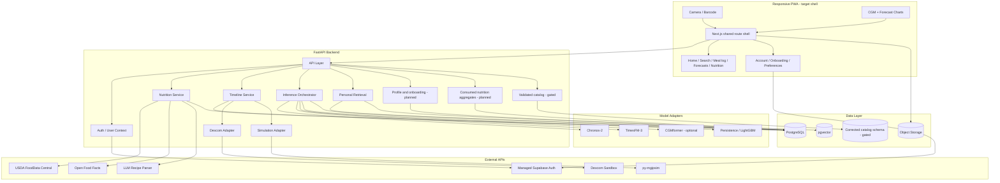
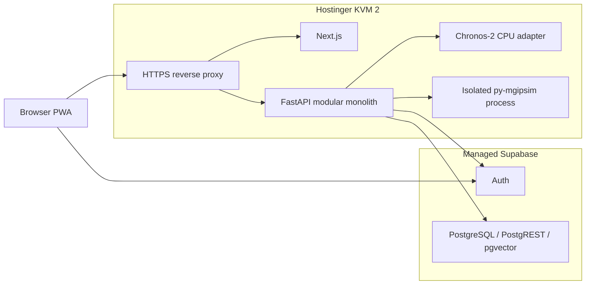

# GlycoLens Tech Stack and System Architecture

## November 14: measured external catalog boundary

The [updated migration design](../reports/azure-to-supabase-catalog-migration-strategy-2026-11-06.md)
selects exact `gold.*.display_status = 'user_ready'` candidates and active products,
with explicit dependency closure. Do not copy production roles, customer/vendor
references, prices or non-gold data. Keep a separately validated, initially
unexposed `catalog` release beside the existing application schema; preserve raw
profile/fact evidence and map singular fact entity types to plural lineage types.
Ready recipes mix 19,111 whole-recipe and 14,083 per-serving profiles; the current
gram-based `public.foods` contract requires a reviewed recipe-serving adapter or
verified cooked mass before activation. Supabase baseline is 15,414,963 bytes on
Postgres 17.11 with no catalog schema; the indexed import allowance is provisional,
not a restored measurement. No schema/adapter implementation or activation occurred.

## November 14: personal and simulation workspaces implemented

Forward cloud migration `20261114173109` adds constrained meal workspace classification, preserving old evidence, and explicit trusted scope/source writes plus a shared scoped aggregate. Source creation no longer changes global app preferences. Owner/RLS, immutable forecast inputs and common adapters remain enforced. Same Auth, monorepo and Compose services. [Actual validation](../reports/workspace-separation-validation-2026-11-14.md) and [44-case ledger](../testing/workspace-separation-results.json): **28 PASS, 16 PARTIAL**. Changes remain local; human Chrome and other qualified gates are not claimed complete.

## November 14: local LightGBM selection enabled for user review

At the user's request, the existing local development runtime now exposes **LightGBM · research option** alongside default Chronos. The ignored local enablement flag is true; the running API's native bundle/digest/read-only mount were verified and real synthetic inference returned 24 ordered points. The shipped environment template remains disabled by default. This is a user-authorized local research exposure for manual testing, not completed L0–L4 acceptance, production enablement or a model default change. All existing history/artifact/owner checks remain enforced.

An existing meal attached to the short one-day source remains ineligible for native inference. Explicitly prepare the 48-hour research source and save a new reviewed meal at that source's clock; existing meal/source snapshots are unchanged. Current carbohydrates are the native meal predictor; matching-outcome accuracy and transferred interval coverage remain unvalidated. [Enablement and verification](../reports/local-lightgbm-enablement-2026-11-14.md). November 12 off-state descriptions below are historical checkpoints; their outstanding acceptance results remain valid.

## November 12 implementation outcome — current status

One FastAPI process now owns an allowlisted versioned registry shared by ordinary and portion inference, with bounded locks and explicit readiness failures. Authenticated `GET /api/v1/forecasts/models` advertises capabilities; POST forecasts accepts allowlisted optional `model_key`, default Chronos. The native loader verifies a narrow server-selected read-only bundle; the 48h simulator uses a distinct protocol/cache. Model-specific builders freeze units/masks/chronology and full model/calibration identity into idempotent cloud snapshots. Forward migration `20261113031950` enables backward-compatible v2 calibrated signed intervals and RPC identity validation, with invoker/service-only grants retained. Root CPU Compose packages both dependencies, no new service or local Supabase. [Architecture and actual checks](../reports/lightgbm-app-validation-2026-11-12.md). Ordinary native gate remains false; isolated review only.

The dated planning/checkpoint entries below remain historical where they describe unexecuted work.

## November 12: planned common-registry model integration

Keep FastAPI and common adapters; do not create a separate LightGBM service.
[Plan 18](GlycoLens_18_M2_Closure_and_LightGBM_Integration.md) specifies a server-owned registry shared by ordinary/scenario
inference, model-specific context builders and immutable bundle/feature/calibration
identity. LightGBM needs a real trusted-artifact loader, compatible pinned CPU
dependencies and narrow read-only serving bundle mount. The new synthetic protocol
must provide 24h past history plus withheld future without changing old replay.
Version API/SQL/frontend interval semantics before enablement: saved calibrated
bands can exceed current bounds, and clipping/equal placeholders are unacceptable.
No schema/model/runtime change is executed by this documentation. Managed cloud
Supabase remains the only current app database target.

## November 12: one-command local containers

Root `compose.yaml` starts Next.js plus one FastAPI worker with
`docker compose up --build -d --wait`. Chronos remains the existing CPU adapter;
py-mgipsim has an isolated Linux interpreter and pinned upstream source inside the
API image. Managed cloud Supabase remains external. No local database or separate
forecasting service is introduced. Model weights mount read-only; private simulator
artifacts persist in the existing host bind directory, shared with the PowerShell API
so deletion cleanup cannot acknowledge files in a different empty store. Public frontend configuration is baked at build
time, while private keys enter the API only at runtime. See [ADR 0021](../decisions/0021-local-compose-runtime.md)
and [local instructions](../../infra/README.md). Liveness does not prove model/cloud
readiness; an explicit opt-in smoke exercises the real simulator and cached model.
Hosting template `infra/compose.yml`, HTTPS/domain, restore and hosted capacity
acceptance remain separate. Logout reuses managed Auth and existing revoked-session
API/RLS checks; header/demo controls add no custom password/logout API.

## Implementation checkpoint - November 11, 2026

Cloud schema, trusted writes, permanent-account development Auth/onboarding and
the responsive application shell are implemented. Common meal capture/history/
edit/cancel, immutable Chronos forecasts, Home/daily/seven-day consumed nutrition,
owned notifications/export, portion comparisons and genuinely later virtual
observations now have code and scoped test evidence. The original demo moved to
`/demo`; `/` is a public entry and private routes require account/onboarding.

This is a **partial validation checkpoint**, not full phase/release acceptance.
Corrected catalog/search/details/favorites, real email verification/recovery,
verified anonymous upgrade, provider retention/restore, physical-device/manual accessibility,
scratch replay/restore and hosted acceptance remain open. Keep these changes local
for review; scratch replay is explicitly deferred. See the
[implementation report](../reports/webapp-implementation-checkpoint-2026-11-11.md),
[ADR 0019](../decisions/0019-trusted-cloud-writes-and-frozen-source-context.md) and
[actual case ledger](../testing/webapp-validation-results.json). Earlier dated
prototype/preparation evidence below remains historical.

The user confirmed **immediate account deletion after explicit confirmation,
with no recovery window**. Password reauthentication, hard Auth deletion, owned
row cascades and retryable private-file cleanup are implemented and validated with
synthetic accounts. See [ADR 0020](../decisions/0020-immediate-account-deletion.md)
and [deletion evidence](../reports/account-deletion-validation-2026-11-11.md).
Provider backup/log retention, restore reconciliation and a support contact remain
public-release gates; there is no application undo snapshot.

November 11 integration preparation: cloud MCP access and private environment
configuration are verified; hosted application schema/Auth remain pending.
Privileged food caching now prefers `SUPABASE_SECRET_KEY` on the `apikey` header
without a bearer JWT. Legacy `SUPABASE_SERVICE_ROLE_KEY` retains its original
headers only as a fallback. Ordinary user operations still use the user's JWT/RLS.
Public environment names retaining `ANON_KEY` accept the project's modern
publishable key. Eight focused offline tests passed; this is not cloud-user/RLS,
SMTP or live-provider acceptance. The user-selected recipe model is now
`gpt-6-luna`, replacing the earlier `gpt-5-mini` setting. It uses the existing
Responses API strict JSON schema, validation and editable ingredient contract;
forecasting adapters and nutrition-source authority are unchanged. A user-approved
USD 5 total cap covered a 16-call synthetic comparison: both models passed eight
cases after a documented offline oracle correction. Live access and token usage
are verified; representative accuracy and production cost remain unproven. See
[recipe validation](../reports/recipe-model-validation-2026-11-11.md) and
[setup evidence](../reports/cloud-env-and-email-setup-2026-11-11.md).

Current environment decision: [ADR 0018](../decisions/0018-cloud-supabase-and-staged-webapp-delivery.md)
sets **dedicated cloud Supabase development** as the application DB/Auth and hosted
integration-test target from now on. The one-repo modular monolith remains.
[Plan 17](GlycoLens_17_Webapp_Implementation_Plan.md) specifies reviewed hosted
migration creation, modern API-key compatibility, trusted writes, phase deliverables
and 144-case validation. Historical local stack setup/reset instructions are not
the new workflow; no hosted schema has yet been applied by this planning update.

November 10 UI architecture update: [ADR 0017](../decisions/0017-responsive-webapp-and-figma-reference-boundary.md) adopts an incremental responsive Next.js shell around the existing authenticated meal/forecast workflow. The [detailed UI architecture](../architecture/responsive-webapp-ui.md) defines routes, component boundaries, minimal onboarding, proposed schema/API additions and responsive acceptance. The [44-node Figma audit](../reports/figma-reference-review-2026-11-10.md) supplies reference evidence. These are design/documentation changes; no new route, migration, cloud connection or runtime UI is claimed.

## 1. Architecture principle

November 6 catalog proposal: [ADR 0015](../decisions/0015-corrected-nutrition-catalog-migration.md)
and the [measured migration strategy](../reports/azure-to-supabase-catalog-migration-strategy-2026-11-06.md)
describe a compact, corrected Azure food-data copy into a separate Supabase catalog schema.
Recipe data remains deferred until correction and validation. No source writes, cloud
import, nutrition-provider replacement or application-schema implementation has occurred. The
modular monolith and private application/research boundaries remain intact.

Use a **modular monolith + separate model adapters**, not microservices.

Reason:
- one student
- short semester
- easier deployment/debugging
- model adapters still make forecasting components replaceable
- avoids distributed-systems overhead that does not contribute to the capstone goal

## 2. Recommended stack

| Layer | Technology | Why |
|---|---|---|
| Client | **Next.js + TypeScript** | Fast web development; PWA support; laptop + mobile |
| UI | Plain CSS and reusable React components currently; shared design tokens/components planned | Keep existing stack; no Tailwind/component-library migration required |
| Charts | SVG forecast chart currently; responsive summary/table extension planned | Preserve validated contract and accessible data; no chart-library dependency assumed |
| Barcode | Browser barcode library (ZXing browser layer or equivalent) | Camera-based UPC/EAN capture |
| Backend | **FastAPI + Python** | Natural fit for model inference/data science |
| Validation | Pydantic | Typed API contracts |
| Data processing | Polars/Pandas + NumPy | CGM/event preprocessing |
| App DB | **PostgreSQL via Supabase** | relational data, auth ecosystem, low student cost |
| Vector retrieval | **pgvector** | similar meals in same database |
| File/object storage | Supabase Storage or local research storage | meal images/exports if needed |
| Forecast models | PyTorch/official model libraries | Chronos/TimesFM/CGM adapters |
| Nutrition | USDA FDC + Open Food Facts | structured nutrition |
| CGM integration | Dexcom OAuth 2.0 API | sandbox integration |
| Simulation | py-mgipsim | controlled virtual T1D data |
| Testing | Pytest + Playwright | backend + critical UX flows |
| Packaging | Docker | reproducible backend/model environment |
| Initial hosting | Hostinger KVM 2 + managed Supabase | user-selected November 7 target; hosted acceptance pending |

Milestone 1 pins the local development toolchains to Python 3.12.5 managed by uv and Node.js 22
managed as a pnpm workspace. Exact resolved dependencies are recorded in `uv.lock` and
`pnpm-lock.yaml`. Backend and model packages are added only alongside exercised implementation and
tests, avoiding a large speculative environment.

Milestone 1 Phase 3 adds an optional `chronos` dependency group with
`chronos-forecasting==2.3.2` and `psutil==7.2.2`. The exact `amazon/chronos-2` checkpoint revision
is pinned in the adapter. Checkpoints and benchmark records remain under ignored `artifacts/`
directories and are never application/database assets.

Milestone 1 Phase 4 adds FastAPI/Pydantic transport dependencies and a lightweight Matplotlib
research-plot dependency group. The Next.js app adds Vitest and Testing Library for executable
component and API-client behavior. The browser demonstration remains independent of model loading:
it consumes a deterministic synthetic response mapped through the canonical forecast contract.

Milestone 1 Phase 5 implements the database contract in the standard `supabase/` CLI layout. The
initial migration creates ten application tables, installs pgvector, applies integrity constraints
and indexes, and enables RLS in the same transaction. Generated local configuration and connection
details are ignored. The migration is validated locally before any hosted project is linked.

Milestone 1 Phase 6 integrates the source-only py-mgipsim repository at exact commit
`b985f8c2ea385d1b2b8480957b730866e07772f1`. Its 68 resolved packages use a separate lock and
ignored Python environment under `.cache/`. GlycoLens invokes it as an opt-in subprocess and
normalizes only relative-time simulated glucose plus aggregate metadata into ignored
`artifacts/simulation/`. It is deliberately not imported into FastAPI or persisted to Supabase in
Milestone 1; live application integration remains Milestone 2 work.

## 3. Why a PWA instead of native iOS/Android

Next.js now documents a direct PWA path supporting home-screen installation and app-like behavior without separate codebases or app-store approval.

For this capstone:
- the barcode workflow can use a mobile camera
- Dexcom OAuth works through browser redirects
- charts work well in a responsive browser
- the panel can run the app without installation
- updates are instant

If later moved to native:
- keep FastAPI/Postgres/model architecture
- replace Next.js client with React Native/Expo

## 4. High-level architecture

This is the target system decomposition, not a deployment or feature-completion diagram. Dexcom, semantic vectors, optional models/object storage and new responsive routes are planned or separately gated. Current app inference is Chronos C3; research adapters/evaluations are not all selectable application services. See section 6 for the implemented boundary.



## 5. Model adapter interface

The backend should not hard-code Chronos or TimesFM logic into routes.

Implemented interface:

```python
class ForecastModelAdapter:
    model_id: str
    model_version: str

    def load(self) -> None:
        ...

    def predict(self, request: ForecastRequest) -> ForecastResult:
        ...
```

`ForecastRequest` is the only object accepted by model code. It contains target history, past
covariates, known-at-forecast covariates, prediction length, frequency, and quantiles. It cannot
contain held-out future CGM or participant identifiers. `ForecastTarget` remains separate and is
paired with the request only inside an evaluation-only `ForecastExample`.

`ForecastResult`:

```text
model_id
model_version
context_start
context_end
forecast_timestamps[]
median[]
quantile_10[]
quantile_90[]
latency_ms
metadata
```

All values and shapes are validated before a result crosses the adapter boundary. Forecast
timestamps must be strictly future and regular; q10 <= q50 <= q90 is enforced pointwise. The
canonical contract lives under `research/models/adapters/`. The Phase 4 Pydantic transport schemas
map `ForecastResult` into relative-minute history, q10/q50/q90 bands, and 30/60/120-minute summaries
rather than duplicate inference behavior in routes or backend models.

Benefits:
- simple model swapping
- reproducible experiments
- easy research mode
- clean separation between app and model logic

MetaboNet Phase 4 adds a research-only `MetaboNetTabularAdapter` under that contract
([ADR 0012](../decisions/0012-metabonet-direct-model-selection.md)). Request-only
features preserve recorded five-minute IU/gram amounts and masks. Ridge uses
train-only imputation/scaling and 24 joint delta outputs; LightGBM is a pooled-horizon
delta regressor, expanded only after subject splitting. The experiment runner freezes
training-CV choices before validation and keeps checksummed trusted model bundles
under ignored artifacts. Equal quantile fields are explicitly deterministic;
calibration remains separate. Research data/models do not enter the app database
or replace its inference service through this experiment.

## 6. Backend modules

### M2 implemented boundary - October 14

Authenticated routes share `/api/v1`: demo/session, timeline, meals (save/read/similar),
foods/search, foods/usda/{id}, foods/barcode/{code}, meals/parse-recipe,
simulation/scenario, and forecasts (create/read). The M1 forecasts/demo route remains
identifier-free. Tokens are verified through local Supabase Auth; user-token PostgREST
and SECURITY INVOKER RPCs preserve RLS. Privileged catalog access is limited to
provider-fetched food facts, never meal/timeline requests.

Forward local migrations add explicit 100-g nutrient basis, source snapshots, input
metadata, idempotency keys, forecast origin/provenance and outcome available_at.
Atomic RPCs calculate totals from food facts, aggregate repeated ingredients, serialize
idempotent operations and reject malformed forecast grids. Retrieval uses same-user
past meals with completed outcomes, then fixed-scale numeric macro distance.

The default model is validation-frozen Chronos C3 with process caching and a bounded
inference lock. Live simulator execution remains an isolated fixed-protocol subprocess
with timeout/lock. A separate private synthetic context export preserves source insulin
units; the public response excludes insulin values. Only pre-origin CGM enters app
storage. Simulation uses an explicitly labeled January 1, 2026 UTC fixture clock,
not a reinterpretation of timezone-naive research records. Recipe extraction uses
configurable OpenAI Responses structured output; live keys/model are prerequisites.

Current source boundaries:

```text
frontend/src/app/                       Next.js entry, layout and CSS
frontend/src/features/meal/             current integrated MealWorkflow
frontend/src/components/ForecastChart.tsx
frontend/src/lib/                       typed application/forecast clients
backend/app/api/                        meals, foods, forecasts, simulation routes
backend/app/core/                       server configuration
backend/app/db/                         verified user session and owner-token access
backend/app/services/                   nutrition, inference, retrieval, simulation
research/models/adapters/              canonical forecast contract/adapters
research/simulation/                   isolated simulator adapter
supabase/migrations/                   executable application schema/RPCs
```

The new shell extracts the current workflow into route-level features rather than creating another inference backend. Proposed Auth/onboarding, dashboard, catalog and account modules remain inside this modular monolith. Frontend client validation supplements server validation and RLS; it never replaces either. Research data and generated artifacts remain outside application storage.

## 7. API surface: implemented versus proposed

All current application routes are versioned under `/api/v1`. Verify the handlers in `backend/app/api/`; do not use the earlier unversioned suggested URLs as executable contracts.

| Current endpoint | Boundary |
|---|---|
| `POST /api/v1/demo/session` | Verified anonymous Auth session; initialize virtual-patient profile |
| `GET /api/v1/timeline` | Authenticated owner/source context |
| `GET /api/v1/foods/search`, `GET /api/v1/foods/usda/{identifier}`, `GET /api/v1/foods/barcode/{barcode}` | Prepared food-provider paths; live validation gates remain |
| `POST /api/v1/meals/parse-recipe` | Editable structured extraction; deterministic food grounding still required |
| `POST /api/v1/meals`, `GET /api/v1/meals/{meal_id}` | Confirmed atomic/idempotent save and owned read |
| `GET /api/v1/meals/{meal_id}/similar` | Same-owner numeric matches with available past outcomes |
| `POST /api/v1/simulation/scenario` | Authenticated bounded simulator/replay execution |
| `POST /api/v1/forecasts`, `GET /api/v1/forecasts/{forecast_id}` | Validated selected-model create/persist/read |
| `GET /api/v1/forecasts/demo` | M1 identifier-free synthetic visualization; no real model loading |

The [UI API contract](../architecture/responsive-webapp-ui.md#7-application-api-additions-and-connection-boundary) proposes `/me` preferences/onboarding, dashboard/nutrition aggregates, validated catalog detail/search, meal/forecast lists, versioned edits, favorites, notifications and portion comparison. These endpoints do not yet exist. Permanent-account Auth uses Supabase SDK flows, not custom password APIs. Dexcom OAuth and restricted research operations remain deferred; do not expose public batch execution to satisfy a route diagram.

## 8. Database schema

The table sketches below describe the original application entities, not the complete current SQL contract. Four checked-in migrations under `supabase/migrations/` define the implemented schema, RPCs, constraints and RLS, including M2 source basis/snapshots and chronology changes. Proposed preferences/onboarding/acknowledgements, optional goals, typed favorites, meal revisions/consumed state and notifications are specified in [UI architecture section 6](../architecture/responsive-webapp-ui.md#6-data-semantics-and-proposed-schema-changes). They require forward migrations and verification; this documentation does not create them.

### `users`
```text
id                # UUID; references auth.users(id)
display_name
mode              # demo / sandbox
created_at
```

### `cgm_readings`
```text
id
user_id
recorded_at       # timestamptz
glucose_mg_dl
trend
source             # dataset / dexcom / simulation
created_at
```

Indexes:
- `(user_id, timestamp)`

### `insulin_events`
```text
id
user_id
recorded_at       # timestamptz
event_type         # bolus / basal
units
source
created_at
```

### `activity_events`
```text
id
user_id
recorded_at       # timestamptz
steps
met
intensity
source
created_at
```

### `foods`
```text
id
name
barcode
source
source_food_id
serving_size
calories
carbs_g
protein_g
fat_g
fiber_g
raw_payload
created_at
```

### `meals`
```text
id
user_id
recorded_at       # timestamptz
name
meal_type
portion_multiplier
calories
carbs_g
protein_g
fat_g
fiber_g
nutrition_provenance
embedding           # pgvector
created_at
```

### `meal_items`
```text
meal_id
food_id
quantity
unit
grams
```

### `forecasts`
```text
id
user_id
meal_id
model_id
model_version
context_config
horizon_minutes
quantiles_json
latency_ms
created_at
```

### `forecast_points`
```text
forecast_id
forecast_at         # timestamptz
q10
q50
q90
```

### `meal_outcomes`
```text
meal_id
actual_30
actual_60
actual_120
trajectory_metrics_json
created_at
```

### Phase 5 authorization and migration boundary

- RLS is enabled on every exposed application table.
- `public.users` is linked to Supabase Auth, and direct ownership policies use `auth.uid()`.
- Child rows such as meal items, forecast points, and meal outcomes inherit authorization through
  their owned parent.
- Anonymous table privileges are revoked. Authenticated clients may read the shared food catalog
  but cannot write it directly.
- The embedding column uses unconstrained `vector` until the embedding model and dimension are
  selected; a vector index is therefore deferred.
- `supabase/config.toml`, endpoints, keys, and runtime state are local and ignored. Only migrations,
  pgTAP tests, and synthetic seed data are versioned.

### Phase 6 simulator boundary

- The official source commit is verified before every execution.
- The simulator dependency graph is isolated from the main application/model environment.
- Only one reviewed one-day ExtHovorka/OpenLoop scenario is supported in Milestone 1.
- Execution requires explicit opt-in and generated trajectories remain ignored local artifacts.
- Normalized output contains relative minutes, simulated glucose, meal count/total, and source
  provenance; it excludes absolute timestamps, real identifiers, and individual insulin values.
- The simulator is a demo/stress source, not formal forecast ground truth or clinical evidence.

## 9. Research data vs app database

Do not dump every raw research dataset into the production-style app database.

Recommended:

### Research pipeline
- Parquet/CSV files
- local/object storage
- Python notebooks/scripts
- event-window cache

### App database
- selected demo timelines
- app-created meals
- forecast results
- personal history

This keeps the Supabase database small and simple.

## 10. Why PostgreSQL + pgvector

The data is relational and time-indexed. A meal has a clear user, timestamp, nutrients, surrounding events and outcome.

pgvector adds:
- semantic meal similarity
- ingredient/text embeddings
- hybrid retrieval with SQL filters

A single database can therefore support:
- application transactions
- timeline queries
- personalization retrieval

Current retrieval is SQL numeric distance; installing pgvector does not mean semantic retrieval is active. Embedding model/dimension/index selection remains deferred. Capacity acceptance follows the measured catalog budget in ADR 0015 and hosting decision in ADR 0016; do not infer capacity from a prototype schema alone.

## 11. GraphRAG decision

### Recommendation: **do not use GraphRAG in the MVP**

GraphRAG is not the right default because:
- most facts are structured numeric/time-series data
- forecasts should come from time-series models, not an LLM
- similar-meal retrieval is a nearest-neighbor problem
- an additional graph database adds development and operational burden
- graph traversal does not naturally improve the forecast target

### If used as a stretch goal

Possible graph:
```text
User
  -> ATE -> MealInstance
MealInstance
  -> CONTAINS -> Food
MealInstance
  -> PRECEDED_BY -> InsulinEvent
MealInstance
  -> HAS_OUTCOME -> GlucoseWindow
```

A separate graph service remains a stretch proposal requiring a demonstrated user benefit and a separate cost/capacity decision. It is not a dependency of this UI plan.

## 12. Security

For the capstone:
- public de-identified datasets
- simulated patients
- Dexcom sandbox
- do not store real PHI unless explicitly approved

Secrets:
- USDA API key only server-side
- Dexcom client secret only server-side
- OAuth refresh tokens encrypted at rest if real accounts are ever used
- no secrets in Next.js client bundles

## 13. Deployment

### Accepted initial deployment - November 7, 2026

The user selected **Hostinger KVM 2 with managed Supabase**. This replaces the
previous provider-unspecified recommendation; it does not establish that deployment
is implemented or tested. See [ADR 0016](../decisions/0016-initial-hostinger-kvm2-managed-supabase.md).

| Component | Initial placement |
|---|---|
| Next.js PWA and HTTPS reverse proxy | Hostinger KVM 2: 2 vCPU, 8 GB RAM, 100 GB NVMe |
| FastAPI, current Chronos-2 C3 CPU adapter | Same VPS, one backend worker initially |
| py-mgipsim | Same VPS, pinned isolated subprocess environment |
| PostgreSQL, Auth, PostgREST/RPC, RLS, pgvector | Managed Supabase; Free initially if measured usage fits |
| Nutrition and recipe-parser APIs | Existing external providers with private configuration |
| Research datasets, batch experiments and Graphify | Local/RIT development environment |



No separate forecasting microservice or automatic research-model promotion is
introduced. Frontend API/Auth environment settings and explicit backend CORS must
match the deployed HTTPS origins. Existing user-token database calls preserve RLS.

### Preparation and acceptance still required

- Add reproducible Linux containers, the Chronos runtime dependencies and portable
  simulator interpreter/source configuration; the current simulator path is Windows-specific.
- Persist model cache and simulator/replay artifacts; warm the model and validate
  readiness beyond the current basic `/health` response.
- Configure DNS/HTTPS, private secrets, managed Supabase migrations/Auth and owner isolation.
- Verify bounded overlapping requests; process-local locks currently return 429
  while the model/simulator is busy. Profile CPU threads before adding workers.
- Measure full-stack latency, memory, CPU credits, quotas and restart/restore behavior
  on the actual VPS. The 810.83 MiB local model smoke peak is not a hosted capacity result.
- Retain the working local demo and add reproducible Compose fallback packaging;
  no Compose file currently exists. Keep bulk research off the app VPS.

Hostinger's CPU credits can limit sustained heavy processing. KVM 4 is an upgrade
option when actual workload evidence justifies it; managed Supabase capacity and
recipe-model API charges remain separate. Pricing/operational assumptions are in
ADR 0016. Self-hosted Supabase, Vercel, Railway and Render are not required initial
services. Corrected Azure data remains subject to ADR 0015 and its capacity gate.

Execution is tracked in the [M3 deployment checklist](GlycoLens_06_Milestones_and_Schedule.md#initial-hostinger-kvm-2-deployment).

## 14. Repository and developer-tooling boundaries

The repository mirrors the modular-monolith design with separate `frontend/`, `backend/`, `research/`, `database/`, and cross-system `tests/` ownership. Repository-scoped Codex skills under `.agents/skills/` govern documentation, architecture, delivery, testing, review, measurement, and safety.

The November 10 [repository strategy/readiness assessment](../reports/repository-strategy-and-development-readiness-2026-11-10.md)
reaffirms one Git repository. Web/API builds and deployments can be separate;
forecasting currently shares the canonical adapter library rather than a separate
network service. A future worker/service can remain in the same repository.
Independent code-access, team ownership or release requirements would justify
revisiting Git boundaries. Standard Supabase migrations remain in `supabase/`;
`database/` documents that contract rather than owning a second migration history.
The assessment records current CI, packaging, portability and contract gaps without
changing the accepted architecture or performing implementation.

Graphify may be used locally to understand source and documentation relationships. It is a developer-only knowledge tool: it is not product GraphRAG, does not store application data, does not participate in forecasting, and does not reverse the MVP decision to use PostgreSQL and pgvector for similar-meal retrieval.

## References

- Next.js PWA: https://nextjs.org/docs/app/guides/progressive-web-apps
- Supabase pgvector: https://supabase.com/docs/guides/database/extensions/pgvector
- Supabase free tier: https://supabase.com/docs/guides/platform/billing-on-supabase
- Neo4j pricing: https://neo4j.com/pricing/
- Neo4j Free limits: https://neo4j.com/free-graph-database/
- Dexcom developer overview: https://ui-g7int-us.platform.dexcomdev.com/docs/
- USDA: https://fdc.nal.usda.gov/api-guide/
- Open Food Facts: https://openfoodfacts.github.io/documentation/docs/Product-Opener/api/


## MetaboNet Phase 5 completion

An isolated resource audit found that entering the thread-limit context before
loading SciPy/OpenMP can leave those later libraries at 16 threads. The configured
two-thread request is not proof of universal enforcement. Preload numerical
libraries before limits in future profiling; Phase 5 model sources were preserved.

**Phase 5 was complete before the Phase 6 evaluation recorded below.** Frozen C2
generated 6,756 training forecasts; 6,756 usable meals / 196 identities supported six CV
configurations / 18 fold fits and four final refits, with exactly matched direct
controls. Neither correction passed the predeclared incremental gate; retain Phase 4
LightGBM. Lowest-MAE eligible option: `ridge_residual_1000`; advancement candidate:
`lightgbm_direct` (macro MAE 31.17 mg/dL, within +/-10 26.84%). These are
reused-validation findings, not independent confirmation. At Phase 5 completion, calibration/reserved outcomes were untouched.
Phase 6 below supersedes that access status; app inference remains unchanged.
See [protocol 15](GlycoLens_15_MetaboNet_Chronos_Correction.md) and [results](../reports/metabonet-phase5-correction-2026-10-16.md).

The common-contract residual adapter saves only head state and explicitly attaches a frozen backbone after reload. Shared regression helpers preserve prior direct predictions. Two source freezes separate training forecast caching from head fitting; labels are absent from the backbone cache. No API/database changes. See [ADR 0013](../decisions/0013-frozen-chronos-correction-and-matched-controls.md).

## MetaboNet Phase 6 completion - current status

**The broader-data model-refinement sequence, Phases 1-6, is complete.** Separate calibration used 48 participant representatives from 1,488 eligible meals. Frozen LightGBM scored 29.91 mg/dL macro trajectory MAE / 28.20% within +/-10 on 3,533 primary-test meals (102 IDs), and 40.92 / 19.57% on 2,177 PEDAP meals (64 IDs). Both predeclared point-improvement gates passed, with zero failed forecasts; tight precision remains poor. Nominal 80% marginal coverage was 79.05% primary and 63.94% PEDAP. Both test cohorts are now consumed; no test-based reselection, point refit, app promotion or full-M2 closure.

A symmetric interval wrapper preserves the immutable common adapter and unchanged point state. A dedicated reserved reader requires verified calibration completion; development-window role guards remain intact. Two source/configuration freezes form a hash chain. No API, database or frontend changes.

See [protocol 16](GlycoLens_16_MetaboNet_Independent_Evaluation.md), [independent results](../reports/metabonet-phase6-independent-2026-10-16.md) and [verification handoff](../tooling/metabonet-phase6-handoff-2026-10-16.md).
